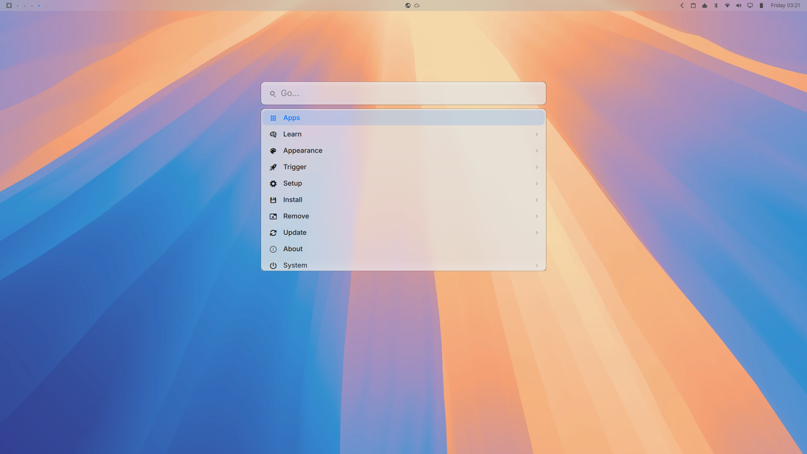

# Sequoia Light

A macOS Sequoia-inspired theme for [Omarchy](https://omarchy.org/) (light mode).



## Install

```bash
omarchy theme install https://github.com/adhilroshan/omarchy-sequoia-light
```

## What's included

- Apple's macOS Sequoia system palette (light mode) with the default blue accent
- Frosted glassy surfaces, rounded corners, hairline window borders
- Authentic macOS Sequoia wallpapers (Light + Sunrise forest)
- A matching dark variant: [Sequoia](https://github.com/adhilroshan/omarchy-sequoia)

## License

MIT
